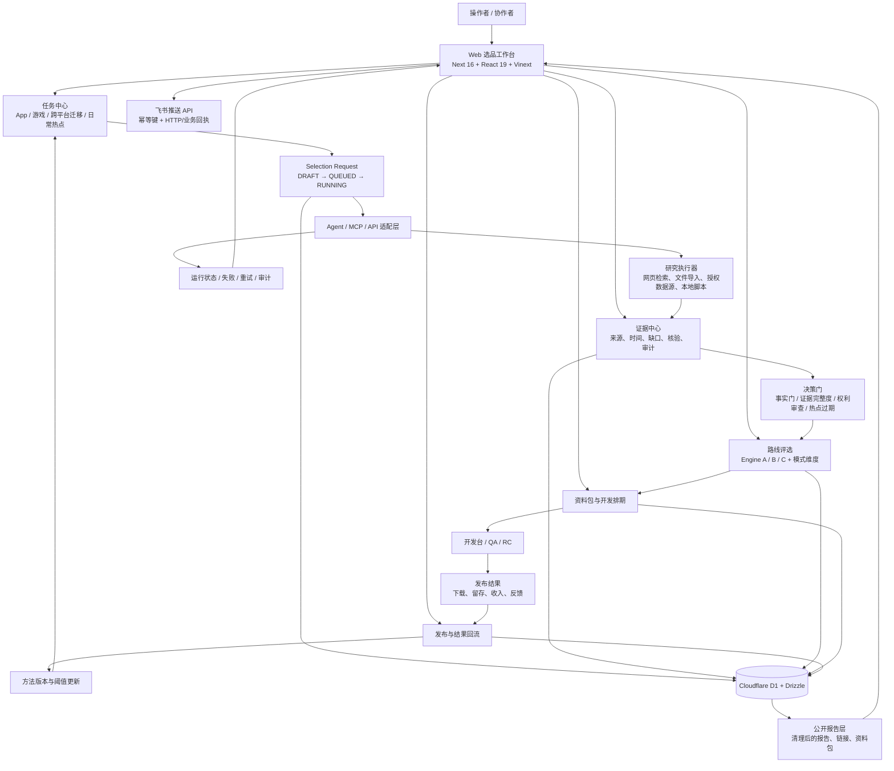

# APP 选品系统最新架构图

更新时间：2026-11-11

## 核心边界

- 网站负责任务、证据、决策、交付与回流的可见操作；不把研究建议直接写成已立项。
- Agent/MCP 是执行适配层，必须返回统一 `skill-task` / `skill-result` 信封、来源、耗时、状态和错误。
- D1 是历史报告、候选、资料包、任务、证据、运行和审计的持久层。
- 公开报告只展示清理后的证据摘要；密钥、Cookie、Webhook、付费原始数据和本机路径留在服务端。
- App、游戏、迁移、热点共享流程，但分别保留模式字段和路线内评分，禁止跨路线混排总分。
